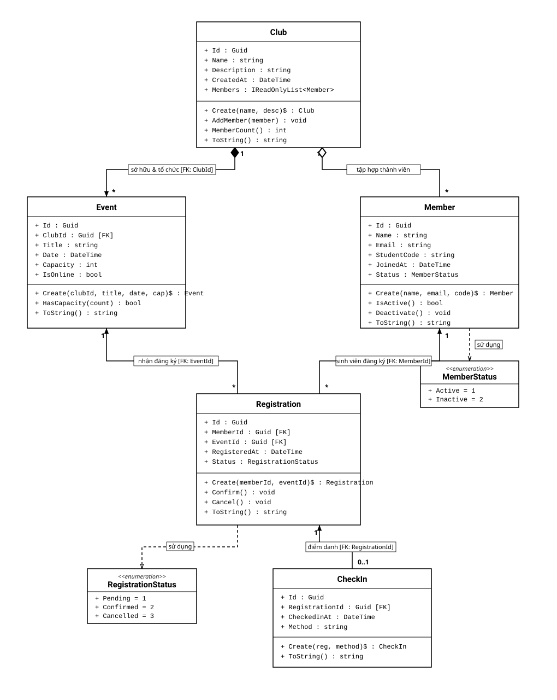

# EDUHUB — HỆ THỐNG QUẢN LÝ CÂU LẠC BỘ & SỰ KIỆN SINH VIÊN
**Học phần:** IN4211 — Phát triển phần mềm hướng đối tượng  
**Giảng viên:** ThS. Nguyễn Tuấn Kiệt  
**Đơn vị:** Khoa Công nghệ và Kỹ thuật — Trường Đại học Đồng Tháp (DThU)  
**Bài tập:** CH01 — Phân tích yêu cầu và Domain Modeling EduHub  

---

## 1. Giới thiệu tổng quan
**EduHub** là dự án phần mềm số hóa quy trình quản lý các Câu lạc bộ (CLB) và Sự kiện ngoại khóa dành cho sinh viên Trường Đại học Đồng Tháp.

Trong bài tập **Chương 1 (CH01)**, dự án thực hiện:
- Phân tích 5 User Stories nghiệp vụ cốt lõi gắn liền với các thực thể.
- Thiết kế Sơ đồ lớp (UML Class Diagram) trực quan hóa quan hệ thực thể, bội số và khóa ngoại.
- Hiện thực hóa 5 lớp thực thể bằng ngôn ngữ C# (.NET 10) tuân thủ tính đóng gói (Encapsulation), Static Factory Method `Create()`, kiểm tra dữ liệu đầu vào và quản lý trạng thái qua Enum/Hằng số.
- Xây dựng ứng dụng **Console tương tác (Interactive Console)** cho phép nhập liệu trực tiếp từ bàn phím, tự động đăng ký, duyệt phiếu, điểm danh (Check-in) và xuất bảng báo cáo.

---

## 2. Mô tả thiết kế Domain (Domain Model Design)

### 2.1 Năm thực thể cốt lõi (Domain Entities)

| Thực thể (Class) | Vai trò nghiệp vụ | Các thuộc tính cốt lõi (Properties) | Phương thức hành vi (Behavior) |
| :--- | :--- | :--- | :--- |
| **`Club`** | Đại diện cho Câu lạc bộ sinh viên | `Id` (PK), `Name`, `Description`, `CreatedAt`, `Members` (`IReadOnlyList<Member>`) | `AddMember()`, `MemberCount()`, `HasMember()` |
| **`Member`** | Đại diện cho Sinh viên trong hệ thống | `Id` (PK), `Name`, `Email`, `StudentCode` (MSSV), `JoinedAt`, `Status` (`MemberStatus`) | `IsActive()`, `Deactivate()`, `Activate()` |
| **`Event`** | Đại diện cho Sự kiện do CLB tổ chức | `Id` (PK), `ClubId` (FK), `Title`, `Date`, `Capacity`, `IsOnline` | `HasCapacity()` |
| **`Registration`** | Phiếu đăng ký tham dự (bảng nối N-N giữa Member và Event) | `Id` (PK), `MemberId` (FK), `EventId` (FK), `RegisteredAt`, `Status` (`RegistrationStatus`) | `Confirm()`, `Cancel()` |
| **`CheckIn`** | Bản ghi điểm danh thực tế tại sự kiện (quan hệ 1 - 0..1 với Registration) | `Id` (PK), `RegistrationId` (FK), `CheckedInAt`, `Method` | `Summary()` |

### 2.2 Các quy tắc thiết kế Hướng đối tượng áp dụng
1. **Encapsulation (Tính đóng gói):**
   - Tất cả thuộc tính đều dùng `{ get; private set; }`, không dùng public setter thô.
   - Constructor có phạm vi truy cập `private` để bảo vệ dữ liệu.
   - Danh sách thành viên trong `Club` được che giấu qua `List<Member> _members` nội bộ và chỉ phơi bày ra ngoài qua giao diện chỉ đọc `IReadOnlyList<Member>`.
2. **Static Factory Method `Create(...)` & Validation:**
   - Mọi đối tượng đều được khởi tạo qua phương thức `Create(...)`.
   - Kiểm tra chặt chẽ dữ liệu đầu vào: Tên/tiêu đề không được để trống, email sinh viên bắt buộc chứa ký tự `'@'`, sức chứa `Capacity > 0`, kiểm tra mã GUID không rỗng.
3. **Kiểu dữ liệu an toàn & Nullable Reference Types:**
   - Cấu hình `<Nullable>enable</Nullable>` trong file dự án để ngăn ngừa lỗi Null Reference Exception.
   - Sử dụng Enum cho trạng thái: `MemberStatus` (Active, Inactive), `RegistrationStatus` (Pending, Confirmed, Cancelled).
   - Sử dụng lớp hằng số `CheckInMethod` (`QR`, `Manual`) thay vì chuỗi rải rác (magic strings).

### 2.3 Sơ đồ lớp (UML Class Diagram)

Sơ đồ lớp được thiết kế theo đúng chuẩn kỹ thuật UML (trắng đen, phân cấp trực quan):



> Bản vẽ gốc có thể xem và chỉnh sửa tại: [`docs/class-diagram.drawio`](docs/class-diagram.drawio) (mở trên [app.diagrams.net](https://app.diagrams.net) hoặc VS Code extension).

---

## 3. Cấu trúc thư mục dự án

```text
EduHub.Ch01/
├── Domain/
│   ├── Club.cs               # Thực thể Câu lạc bộ
│   ├── Member.cs             # Thực thể Sinh viên / Thành viên
│   ├── Event.cs              # Thực thể Sự kiện của CLB
│   ├── Registration.cs       # Thực thể Phiếu đăng ký tham dự
│   └── CheckIn.cs            # Thực thể Bản ghi điểm danh (Check-in)
├── docs/
│   ├── user-stories.md       # 5 User Stories cốt lõi bám sát thực thể
│   ├── class-diagram.md      # Tài liệu thuyết minh sơ đồ lớp
│   ├── class-diagram.drawio  # Tệp thiết kế Draw.io (trắng đen)
│   └── class-diagram.svg     # Ảnh vector của sơ đồ lớp
├── Program.cs                # Ứng dụng Console tương tác (cho phép nhập từ bàn phím)
├── EduHub.Ch01.csproj        # Cấu hình dự án .NET 10 (<Nullable>enable</Nullable>)
└── README.md                 # Tài liệu hướng dẫn sử dụng và báo cáo kết quả
```

---

## 4. Hướng dẫn cách chạy ứng dụng

### Yêu cầu môi trường:
- Đã cài đặt **.NET 10 SDK** (kiểm tra bằng lệnh `dotnet --version`).
- Terminal: Command Prompt, PowerShell, bash hoặc terminal trong VS Code.

### Các bước thực hiện:
1. Mở Terminal và di chuyển vào thư mục dự án:
   ```bash
   cd EduHub.Ch01
   ```

2. Chạy ứng dụng bằng lệnh:
   ```bash
   dotnet run
   ```

3. **Nhập dữ liệu trực tiếp từ bàn phím:**
   - **Bước 1:** Nhập tên và mô tả Câu lạc bộ (nhấn Enter nếu muốn dùng mặc định).
   - **Bước 2:** Nhập số lượng thành viên và thông tin từng sinh viên (Họ tên, Email, MSSV).
   - **Bước 3:** Nhập thông tin Sự kiện (Tên sự kiện, Sức chứa chỗ ngồi).
   - **Bước 4:** Hệ thống tự động tạo phiếu đăng ký và duyệt (`Confirm`) cho các thành viên.
   - **Bước 5:** Lựa chọn phương thức điểm danh (`1` để Quét mã QR, `2` để Điểm danh thủ công).
   - **Bước 6:** Xem Báo cáo tổng kết tham dự sự kiện dạng bảng chuẩn.

---

## 5. Ảnh chụp kết quả chạy thực tế (Console Output)

Dưới đây là kết quả thực thi hoàn chỉnh của ứng dụng khi người dùng nhập dữ liệu tương tác từ bàn phím:

```text
==========================================================
      EDUHUB - HỆ THỐNG QUẢN LÝ CÂU LẠC BỘ & SỰ KIỆN     
==========================================================

--- [BƯỚC 1] NHẬP THÔNG TIN CÂU LẠC BỘ ---
Nhập tên CLB: Tech Club
Nhập mô tả CLB: CLB Lập trình & Đổi mới sáng tạo - DThU
-> Đã tạo CLB: Tech Club (Mã: 3fad9e47-4a44-40ce-a308-c5fd2c77731e)

--- [BƯỚC 2] NHẬP THÀNH VIÊN VÀO CLB ---
Nhập số lượng thành viên muốn thêm: 2

Thành viên #1:
  - Họ và tên: Nguyễn Văn An
  - Email: an.nguyen@dthu.edu.vn
  - Mã số sinh viên (MSSV): DH24001
  -> Đã thêm thành công: Nguyễn Văn An (DH24001)

Thành viên #2:
  - Họ và tên: Trần Thị Bình
  - Email: binh.tran@dthu.edu.vn
  - Mã số sinh viên (MSSV): DH24002
  -> Đã thêm thành công: Trần Thị Bình (DH24002)

--- [BƯỚC 3] TẠO SỰ KIỆN MỚI CHO CLB ---
Nhập tên sự kiện: Workshop Lập trình C# hướng đối tượng
Nhập sức chứa tối đa (Capacity): 50
-> Đã tạo sự kiện: Workshop Lập trình C# hướng đối tượng | Sức chứa: 50 chỗ

--- [BƯỚC 4] ĐĂNG KÝ THAM GIA SỰ KIỆN ---
-> Sinh viên Nguyễn Văn An (DH24001) đã đăng ký thành công [Trạng thái: Confirmed]
-> Sinh viên Trần Thị Bình (DH24002) đã đăng ký thành công [Trạng thái: Confirmed]

--- [BƯỚC 5] ĐIỂM DANH SỰ KIỆN (CHECK-IN) ---
Tiến hành điểm danh cho: Nguyễn Văn An (DH24001)
Chọn phương thức (1. Quét mã QR, 2. Thủ công) [Mặc định 1]: 1
-> [CheckIn #c11d01ed] Lúc 16:39:52 12/10/2026 qua [QR] (Phiếu #72a2a9e2)

==========================================================
   BÁO CÁO THAM DỰ SỰ KIỆN: WORKSHOP LẬP TRÌNH C# HƯỚNG ĐỐI TƯỢNG
   Đơn vị: Tech Club | Sức chứa: 50 chỗ
   Số đăng ký: 2 | Đã check-in: 1
==========================================================
MSSV       | Họ tên             | Trạng thái   | Điểm danh
----------------------------------------------------------
DH24001    | Nguyễn Văn An      | Confirmed    | Đã check-in (QR)
DH24002    | Trần Thị Bình      | Confirmed    | Chưa check-in
==========================================================
Chương trình hoàn tất!
```

---

## 6. Lịch sử Commit theo chuẩn Conventional Commits

Dự án được phân chia thành các commit rõ ràng trên nhánh bài tập `ch01/DH24001`:

1. `refactor(domain): enforce encapsulation, factory methods, and business validation`
   - Đóng gói 5 thực thể, áp dụng static factory `Create()`, kiểm tra dữ liệu đầu vào.
2. `feat(demo): update console workflow demo to use factory methods and user input`
   - Viết lại `Program.cs` hỗ trợ người dùng nhập trực tiếp từ bàn phím và in báo cáo.
3. `docs: update user stories, class diagram, and drawio visual specifications`
   - Bổ sung tài liệu phân tích nghiệp vụ và bản vẽ sơ đồ lớp chuẩn UML.
4. `docs: update README with domain design, execution guide, and output logs`
   - Cập nhật toàn diện file README.md với đầy đủ hướng dẫn thực thi và minh họa kết quả.
